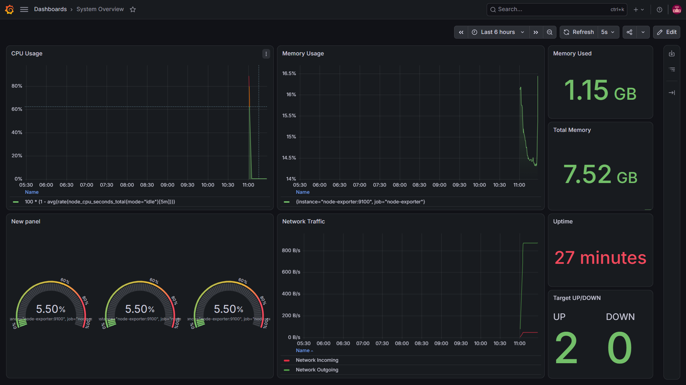
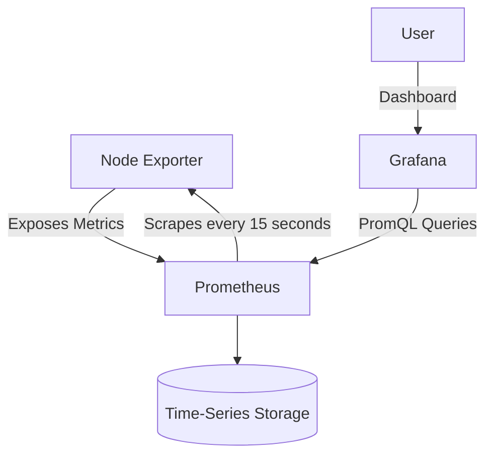

# System Monitoring Dashboard | Prometheus & Grafana

A containerized monitoring stack built with Docker Compose using Prometheus, Node Exporter, and Grafana to collect, monitor, and visualize system metrics in real time.

## Dashboard Preview



## Architecture



- **Node Exporter** – Exposes system metrics for collection.
- **Prometheus** – Scrapes, stores, and queries metrics.
- **Grafana** – Visualizes metrics through an interactive monitoring dashboard.
- **Docker Compose** – Orchestrates the monitoring services.

## Monitoring Overview

The Grafana dashboard provides visibility into the following metrics:

| Metric | Description |
|---|---|
| CPU Usage | CPU utilization percentage |
| Memory Usage | Memory utilization percentage |
| Memory Used | Memory consumption in GB |
| Total Memory | Total memory capacity in GB |
| Disk Usage | Filesystem utilization percentage |
| Network Traffic | Incoming and outgoing traffic rate |
| Uptime | Time elapsed since system boot |
| Targets Status | Number of active and failed monitoring targets |

## Tech Stack

`Docker` · `Docker Compose` · `Prometheus` · `Node Exporter` · `Grafana` · `PromQL`

## Project Structure

```text
monitoring-lab/
├── docker-compose.yml
├── prometheus.yml
├── system-overview.json
├── system-overview.png
└── README.md
```

## Getting Started

### Prerequisites

- Docker Desktop
- Git

### Setup

```bash
git clone <repository-url>
cd monitoring-lab
docker compose up -d
```

Verify the containers:

```bash
docker ps
```

## Access Services

| Service | URL |
|---|---|
| Prometheus | http://localhost:9090 |
| Prometheus Targets | http://localhost:9090/targets |
| Grafana | http://localhost:3000 |
| Node Exporter Metrics | http://localhost:9100/metrics |

## PromQL Queries

**CPU Usage (%)**
```promql
100 * (1 - avg(rate(node_cpu_seconds_total{mode="idle"}[5m])))
```

**Memory Usage (%)**
```promql
100 * (1 - node_memory_MemAvailable_bytes / node_memory_MemTotal_bytes)
```

**Memory Used (GB)**
```promql
(node_memory_MemTotal_bytes - node_memory_MemAvailable_bytes) / 1024 / 1024 / 1024
```

**Total Memory (GB)**
```promql
node_memory_MemTotal_bytes / 1024 / 1024 / 1024
```

**Disk Usage (%)**
```promql
100 * (1 - node_filesystem_avail_bytes / node_filesystem_size_bytes)
```

**Network Incoming (Bytes/sec)**
```promql
rate(node_network_receive_bytes_total{device!="lo"}[5m])
```

**Network Outgoing (Bytes/sec)**
```promql
rate(node_network_transmit_bytes_total{device!="lo"}[5m])
```

**System Uptime**
```promql
time() - node_boot_time_seconds
```

**Targets UP**
```promql
sum(up)
```

**Targets DOWN**
```promql
count(up) - sum(up)
```

## Lifecycle Management

**Start the stack**
```bash
docker compose up -d
```

**Stop the stack**
```bash
docker compose down
```

**Restart services**
```bash
docker compose restart
```

**Check running containers**
```bash
docker ps
```

Docker volumes preserve Prometheus and Grafana data across container recreation.

---

## Notes

Node Exporter is currently deployed as a Docker container without host-level mounts. Therefore, the exposed system metrics represent the container environment and may not reflect the complete Windows host. Filesystem metrics may include container-specific mounts.

This project was built to explore infrastructure monitoring, metrics collection, PromQL, dashboard visualization, and container orchestration.

